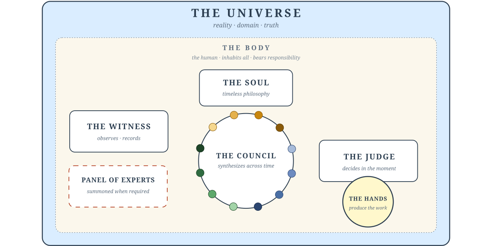

**What it is.** The Soul System is a living philosophy and operational framework
for human–AI collaborative work — research, engineering, science, code. Not a
prompt pack, not a workflow template. A *craft tradition*: a small set of
principles, forged from real failure patterns, that make AI-assisted work more
principled and self-correcting.

**Why.** AI coding assistants are fast and confident — and that's exactly the
problem. They reach for a solution before the problem is framed, pass their own
internal checks while being wrong about reality, and quietly drop the thread
between sessions. The Soul System answers one question: what would it take for an
AI to work like a disciplined craftsperson instead of an eager intern?

## The core idea

- `/soul-init` to add it to a project
- `/soul-handoff` to close out a session and ensure lessons are recorded
- `/soul-resume` to begin a new session built on the recorded lessons and tasks
- `/soul-capture idea|witness|finding` to capture and idea, observation, or data for improving your project

A handful of mandatory gates do most of the heavy lifting:

- **Frame** the problem at two levels — the immediate task and the larger system
  it lives in — before proposing anything.
- **Name the abstraction** before building the instance.
- **Explain why the current state exists** before changing it (don't tear down a
  fence without knowing why it was built).
- **Consult reality** before calling anything done — internal coherence is not
  enough.

## What makes it different

- **Composes, doesn't replace.** Use along with existing workflows and tools.
- **It evolves from its own failures.** Real failure patterns get named —
  *Premature Sophistication*, *Universe Collapse*, *Coherent Falsehood* — recorded,
  and folded back into the philosophy as amendments. The version history *is* the
  lessons learned.

## The measurement story

The system earned its current shape — since 3.0, one short page of rules, a separate
page of the reasons behind them, a set of commands, and a book for humans — by
surviving a measurement program designed to kill it. Five posts tell that story from initial concept (admittedly very philosophical) to current states:

1. [**I gave an AI a philosophy, then tried to prove it was useless**](/blog/soul-system-ablation)
   — the equal-compute ablation. Most of the doctrine was theatre; memory of the
   unguessable wasn't.
2. [**I built the best opponent I could for my AI philosophy. We tied.**](/blog/soul-system-efficacy)
   — the twin-chain efficacy program against a genuinely good generic setup, with
   the scoring locked before anything ran.
3. [**Soul System 2.0: a conscience and a notebook**](/blog/soul-system-2-0) — the
   release post: what survived, what it won't do, and the numbers behind both.
4. [**Is my AI memory system obsolete? I sent 104 agents to find out**](/blog/is-the-soul-system-obsolete)
   — whether the wider ecosystem had made it redundant.
5. [**I re-ran my AI-system benchmark. A good CLAUDE.md kept up — and showed me what to fix.**](/blog/soul-system-who-makes-the-call)
   — the head-to-head re-run on newer models; quality tied again, Soul stayed cheaper
   on long work, and the rulebook was cut by a third for 3.0.

The formal papers behind the posts are on the
[publications page](/publications), and the locked-prediction evidence trail —
every experiment's prediction, scored result, and the program verdict — is
downloadable as a [results bundle](/resources/soul-system/soul-results-bundle.zip).
